# RKR Crackers

Online price list and estimate ordering for RKR Crackers: a website, Android and iOS apps for customers,
and a shop admin for the owner and staff to run orders, money and stock.

Customers pick crackers from the price list (80% off MRP) and send an estimate. No payment is taken online:
the shop calls to confirm, takes payment by UPI, cash or bank transfer, and sends the parcel by lorry transport.
The customer follows the order through to delivery.

- `website/`: the public price list page (static HTML, built from the price-list CSV)
- `app/`: Expo (React Native) app. The same code builds the Android and iOS apps and the website's `/shop` screens
- `backend/`: Django REST API (catalogue, estimates, payments, stock, reports). Django admin at `/django-admin/`

> The screenshots below use sample orders and customers for illustration. Products, prices and shop
> details are the real 2026 price list.

## What customers can do

- Browse all 220 products in 23 categories, with MRP struck through and the offer price beside it
- Search by name or product code, and jump between categories
- Add quantities from the price list. The running estimate total follows them at the bottom of the screen
- Review the cart: change quantities, see MRP total, savings and estimate total
- Log in with a 6-digit code sent to their email. There is no password
- Enter delivery details (filled in from their last order), apply a coupon code and submit the estimate
- Share the estimate on WhatsApp or call the shop from the confirmation page
- Track each order in **My orders**: waiting for our call → confirmed → payment received → packed →
  dispatched (with transport name and LR number) → delivered
- Read the safety guide, terms of sale and privacy policy

| Home | Price list | Cart | Delivery details | My orders |
|---|---|---|---|---|
| 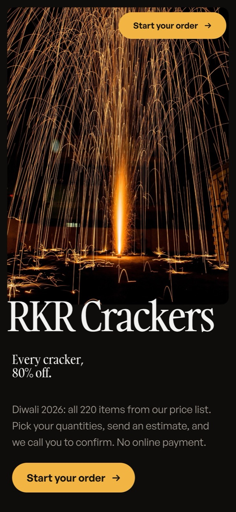 | 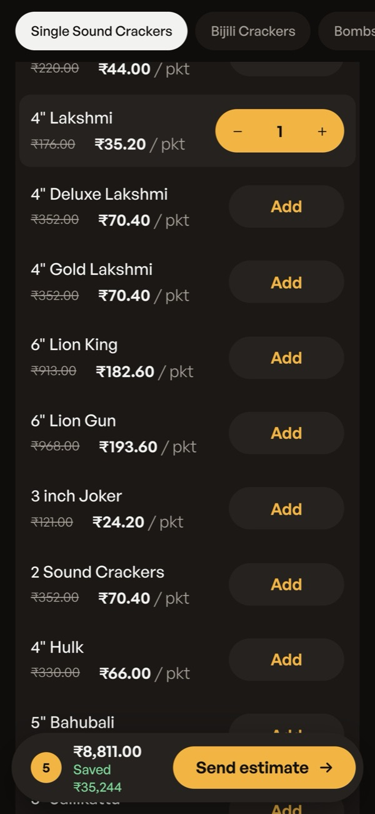 | 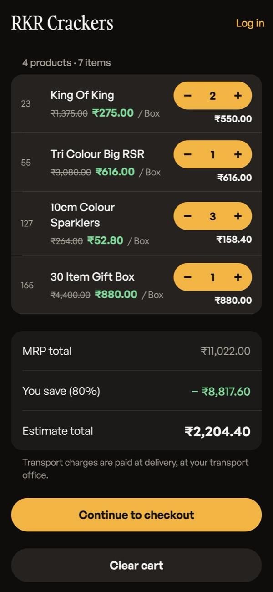 | 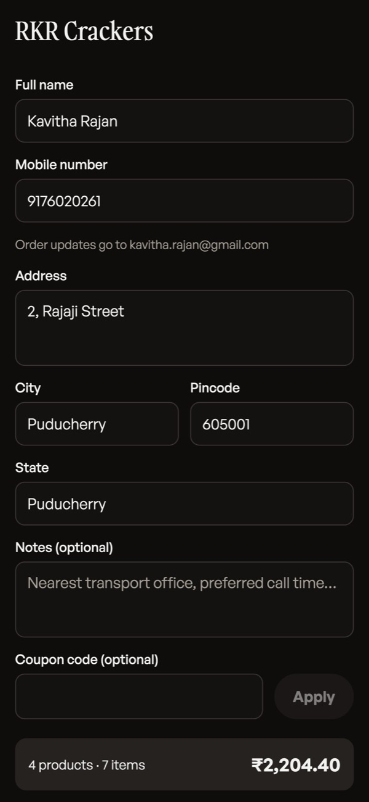 | 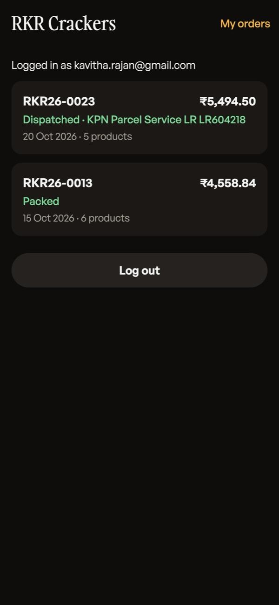 |

| Website: home | Website: price list |
|---|---|
|  | 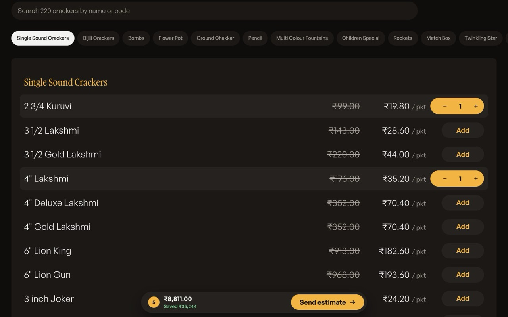 |

All customer screenshots: [website (desktop)](docs/screenshots/customer-web) ·
[mobile](docs/screenshots/customer-mobile)

## What the shop admin can do

The owner (admin) can do everything. Staff can handle orders, dispatch, products, stock and customers;
money, reports, offers, settings and the audit log are admin only. Everyone logs in with an emailed code.

| Area | What it does |
|---|---|
| **Dashboard** | New estimates waiting for a call, confirmed sales, money received, expenses, profit, still to collect, orders by stage, 30-day sales chart, latest orders, best sellers, stock to look at |
| **Notifications** | New estimates, low stock and orders ready to dispatch, with a count on the menu |
| **Orders** | Every estimate, filtered by stage or payment and searched by number, name, phone, city or LR. Open one to call or WhatsApp the customer, move it through each status, change quantities or prices, edit the address and keep private notes |
| **Payments** | Record UPI, cash, bank, card or cheque payments and refunds against an order; see what is still to collect and the full payment ledger |
| **Dispatch** | Orders to pack and send, in transit and delivered. Add transport name, LR number and dispatch date; mark delivered |
| **Customers** | Everyone who has ordered, with their order history, total purchases and balance due |
| **Products** | All 220 products: add, edit, change MRP and discount, switch on or off, and set a video link |
| **Categories** | Add, rename, reorder and hide categories |
| **Inventory** | Track stock per product: restock, correct a count, remove damaged items, low-stock warnings. Confirmed orders take stock automatically and cancelled orders give it back |
| **Offers & coupons** | Seasonal offers by category or for the whole list between two dates; coupon codes (percent or rupees off, minimum order, cap, usage limit, dates) |
| **Expenses** | Stock purchases, transport, packing, wages, rent, power and phone, marketing, licences |
| **Reports** | Sales, money received, expenses and profit for any period, by day, month or year, with CSV downloads |
| **Settings & team** | Shop name, phones, WhatsApp, address, UPI and bank details, minimum order, packing charge, announcement banner; give staff or admin access |
| **Audit log** | Every change: who made it, when and what changed. Entries can't be edited or deleted |

| Dashboard | Order |
|---|---|
| 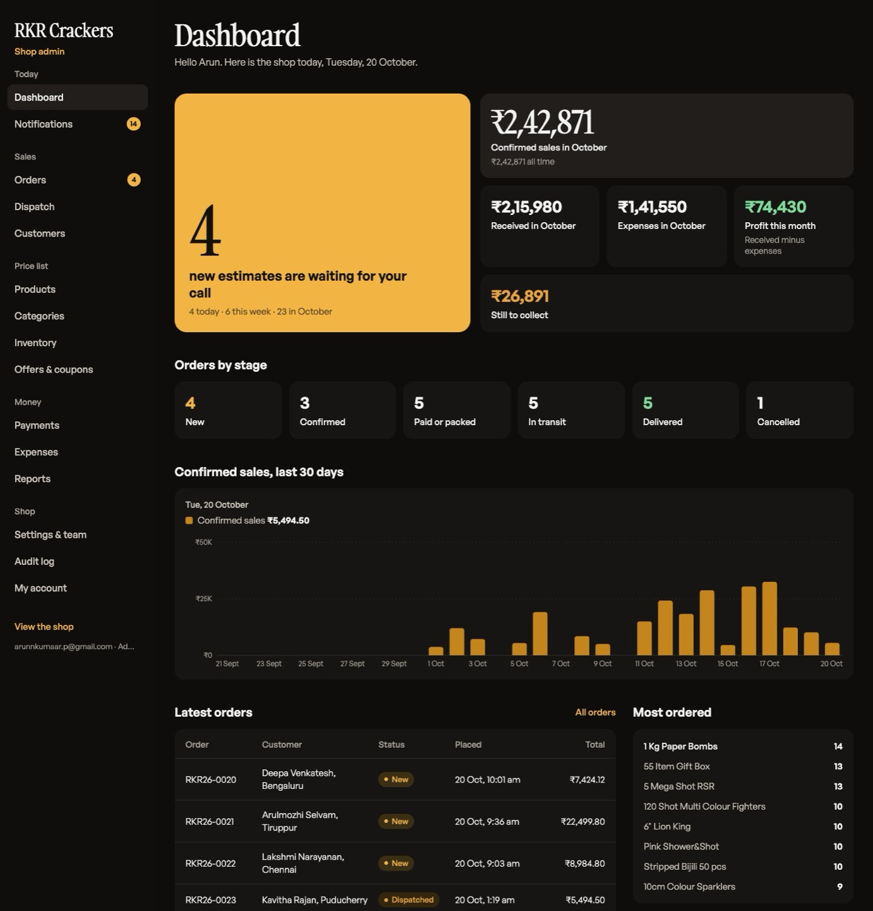 | 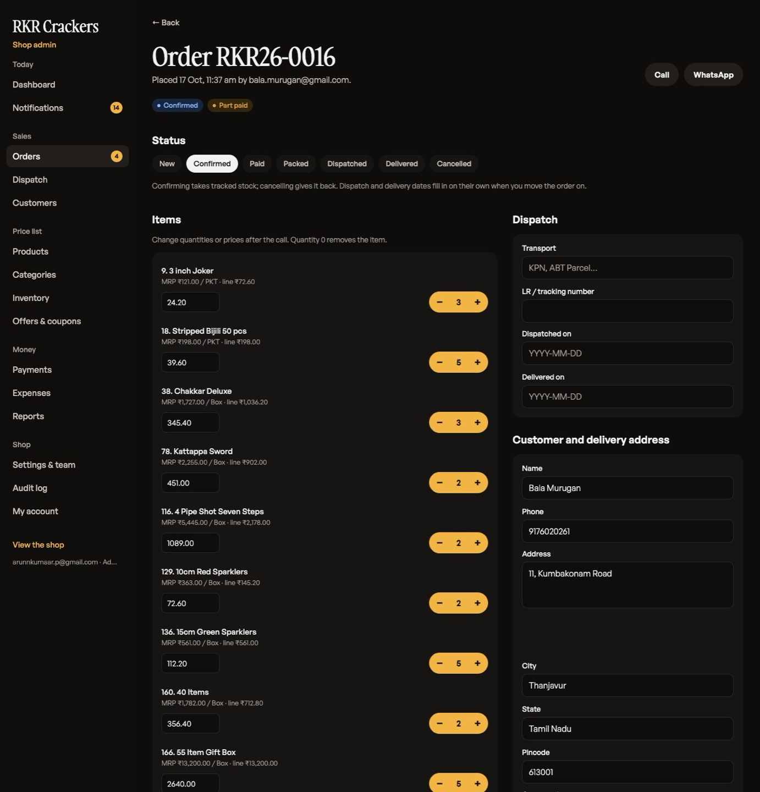 |
| **Dispatch** | **Reports** |
| 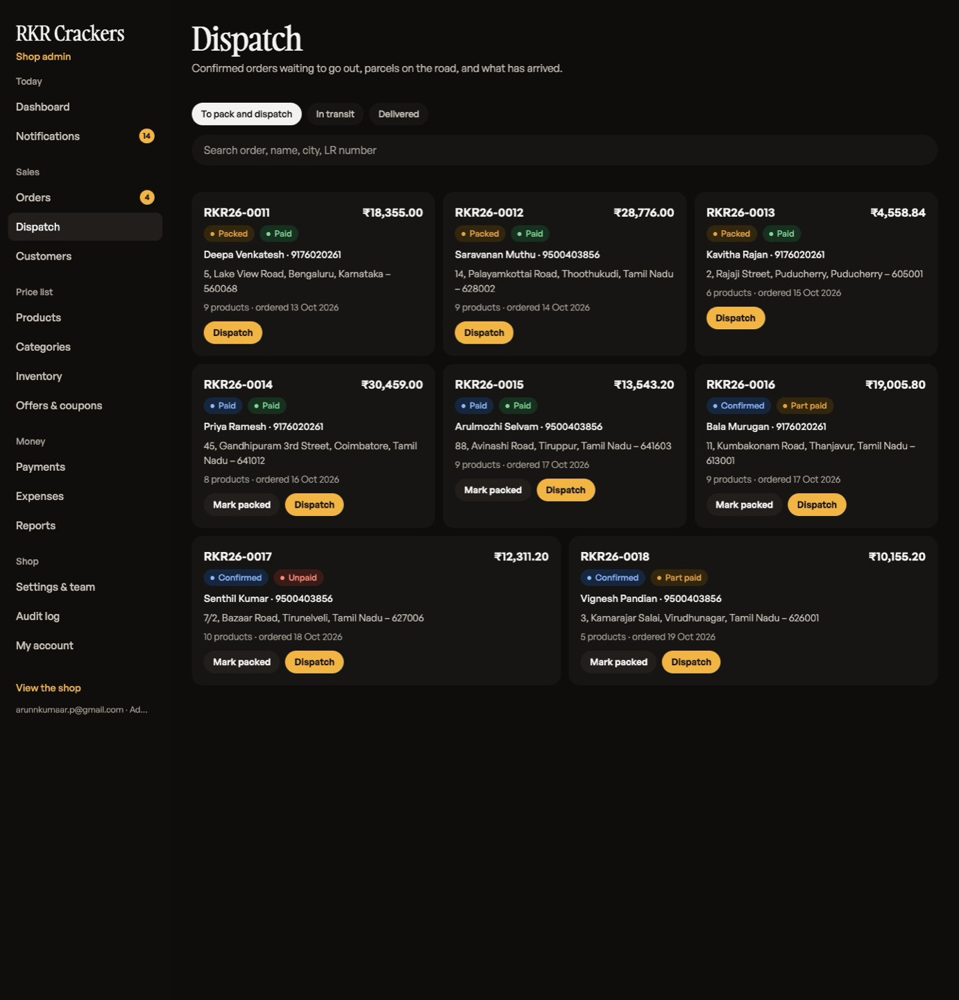 | 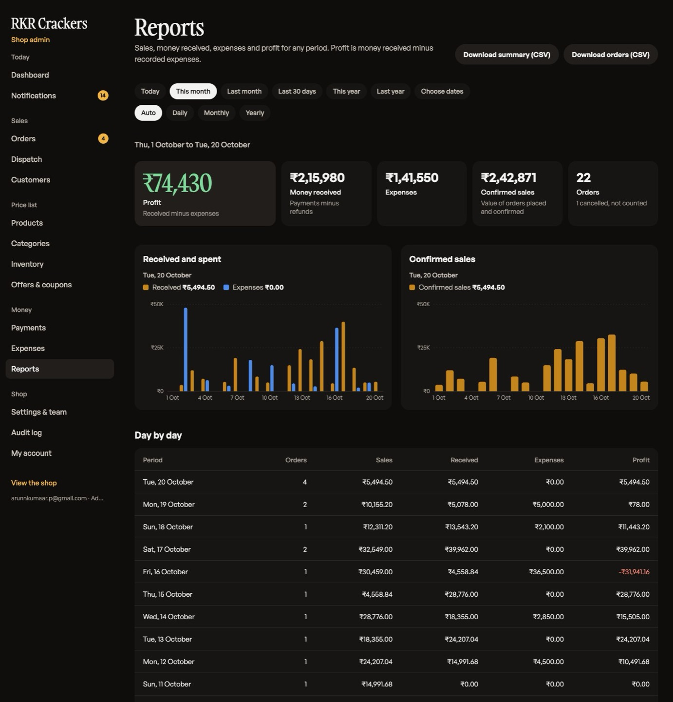 |

| Admin on a phone: dashboard | Orders | Order | Dispatch | Inventory |
|---|---|---|---|---|
| 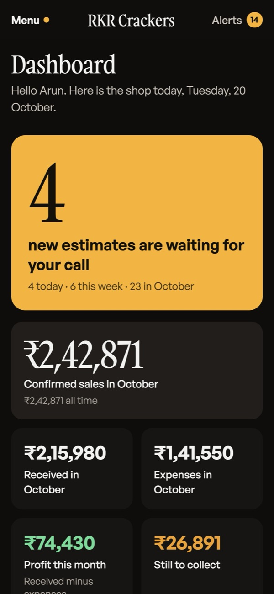 | 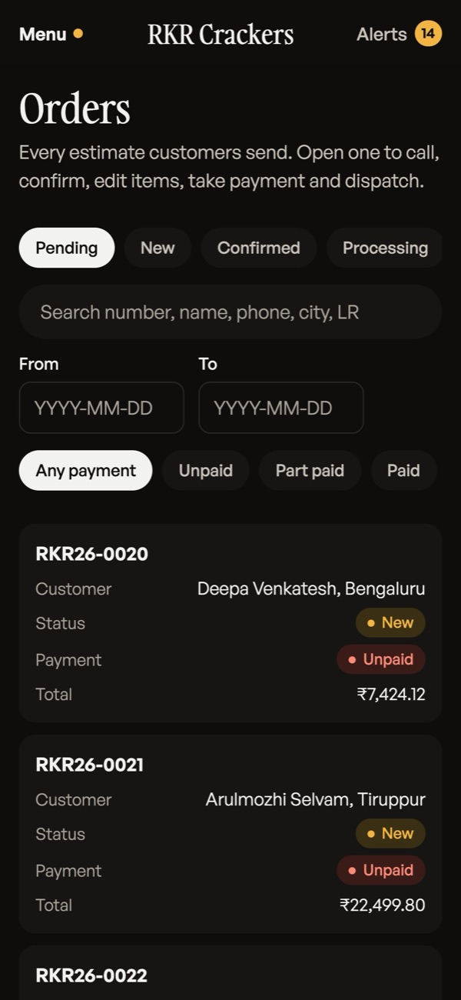 | 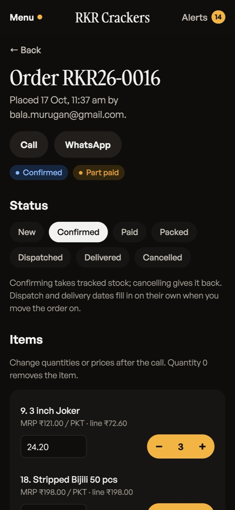 | 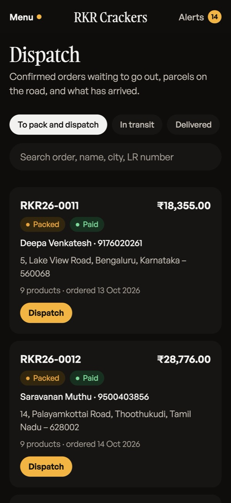 | 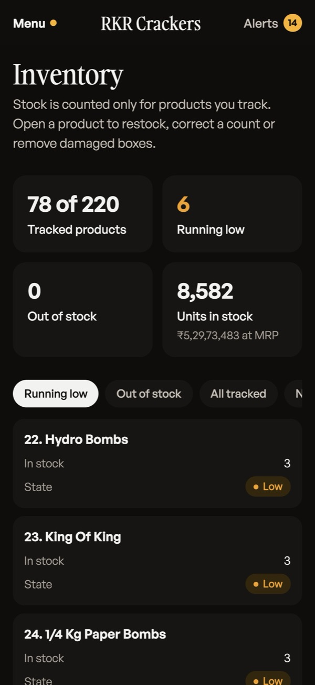 |

All admin screenshots: [desktop](docs/screenshots/admin-desktop) · [mobile](docs/screenshots/admin-mobile)

## Run

```bash
cp backend/.env.example backend/.env
docker compose up -d --build
docker compose exec backend python manage.py migrate
docker compose exec backend python manage.py import_products   # loads seed/products_2026.csv
docker compose exec backend python manage.py createsuperuser
docker compose exec backend pytest

cd app && cp .env.example .env && npm install && npx expo start   # a = Android, i = iOS (Expo Go)
```

**Website** (`website/`): a static page built from the price-list CSV, designed with the taste-skill
(`.claude/skills/design-taste-frontend`, direction "split stage"). The app's web screens (cart, checkout,
login, orders, admin) are served under `/shop` and share the cart with the page through the browser.

```bash
scripts/build-web.sh            # website + app web build into dist/
node scripts/serve-web.mjs      # http://localhost:8081 (website at /, app at /shop)
node .claude/skills/design-taste-frontend/scripts/inspect.mjs website/index.html   # design gate
```

On a phone or Android emulator, set `EXPO_PUBLIC_API_URL` to your computer's LAN IP (or `http://10.0.2.2:8000/api/v1` for the emulator).

**Login codes by email.** Without SMTP settings, codes are printed in the backend log
(`docker compose logs backend`). To send real emails through Gmail, turn on 2-Step Verification, create an
App Password at https://myaccount.google.com/apppasswords and set in `backend/.env`:

```
EMAIL_BACKEND=django.core.mail.backends.smtp.EmailBackend
EMAIL_HOST=smtp.gmail.com
EMAIL_PORT=587
EMAIL_HOST_USER=you@gmail.com
EMAIL_HOST_PASSWORD=<16-character app password>
DEFAULT_FROM_EMAIL=RKR Crackers <you@gmail.com>
```

**App icon and splash**: `node app/scripts/make-icons.mjs` regenerates them from code. They show in
development builds and store builds, not in Expo Go.

Shop settings (UPI ID, UPI QR image, minimum order, packing %) are edited in the shop admin under **Settings & team**.

## Deploy

**Backend** (any Docker host: Render, Railway, a VPS). The image runs `start.sh`: migrate, collectstatic, gunicorn on `$PORT`.
Set `DJANGO_DEBUG=0`, `DJANGO_SECRET_KEY` (long random string), `DATABASE_URL` (managed Postgres),
`DJANGO_ALLOWED_HOSTS`, `CORS_ALLOWED_ORIGINS`, `CSRF_TRUSTED_ORIGINS` and the `EMAIL_*` SMTP settings (see `backend/.env.example`).
Mount a persistent disk at `/app/media` so the UPI QR upload survives redeploys. Then run
`python manage.py import_products` once and `python manage.py createsuperuser` with your email.

**Website**: `API_URL=https://<api-host>/api/v1 scripts/build-web.sh`, then upload `dist/` to Cloudflare Pages with one
rewrite: `/shop/*` → `/shop/index.html`.

**Mobile apps**: `npx eas-cli@latest build` with the same `EXPO_PUBLIC_API_URL` (store submission is handled separately).
